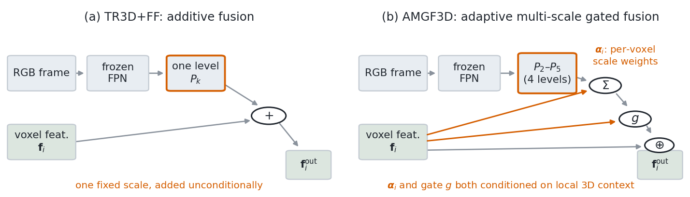
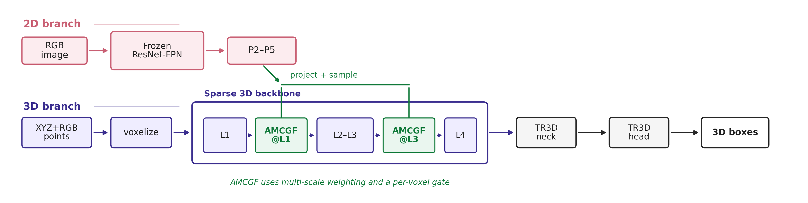
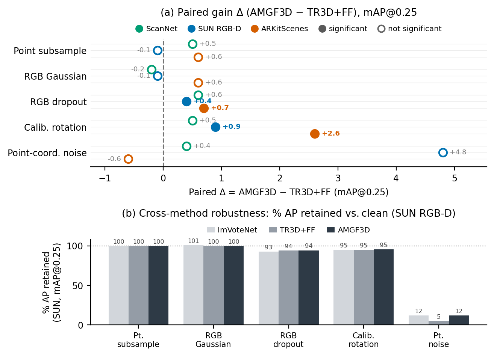
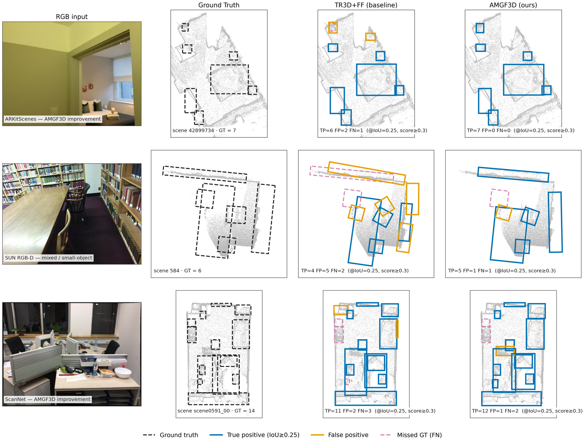

## AMGF3D: Adaptive Multi-scale Gated Fusion for Robust Indoor RGB-D 3D Object Detection

**News: our paper is accepted at BMVC 2026.**

Faisal Ahmed, John Quarles, Kevin Desai — Department of Computer Science, University of Texas at San Antonio

This repository contains the implementation of **AMGF3D**, a selective RGB-D fusion module for
sparse-voxel indoor 3D object detectors. Projection-based fusion normally ties every 3D location to a
single, fixed-scale 2D descriptor and injects it unconditionally. AMGF3D instead

* aggregates all four FPN levels (`P2`–`P5`) with **per-voxel scale weights** predicted from the
  voxel's own 3D feature, and
* **gates** the injected appearance on the joint geometry–appearance pair, so a voxel whose projected
  evidence disagrees with its geometry can suppress it,

applied at **two backbone stages** while retaining single-pass inference. The module adds `+0.6%`
parameters and about `9%` runtime over additive fusion.

<p align="center"></p>

The paper's emphasis is robustness rather than peak clean accuracy: this repository therefore also
ships the **perturbation harness** and the **synthetic calibration testbed** used for the evaluation.

<p align="center"></p>

### Installation

The code is built on [mmdetection3d](https://github.com/open-mmlab/mmdetection3d) (v1.0.0rc) and
follows the same setup as [TR3D](https://github.com/filaPro/tr3d). Please refer to the original
[getting_started.md](docs/en/getting_started.md) for full installation instructions.

The sparse 3D stream requires [MinkowskiEngine](https://github.com/NVIDIA/MinkowskiEngine), which is
not vendored here. A working environment is captured in [`tr3d_env_clean.yaml`](tr3d_env_clean.yaml):

```shell
conda env create -f tr3d_env_clean.yaml && conda activate tr3d
pip install -v -e .
```

Most of the `configs` in this repository use 2 GPUs; ARKitScenes and SUN RGB-D runs in the paper used
a single NVIDIA L40S.

### Datasets

Follow the mmdetection3d conventions. Preparation scripts for the reconstructed indoor datasets are
under [`data/`](data). AMGF3D needs **posed RGB frames** in addition to the point clouds, so run the
posed-image extraction step for ScanNet:

```shell
python data/scannet/extract_posed_images.py
python tools/create_data.py scannet --root-path ./data/scannet --out-dir ./data/scannet
```

SUN RGB-D is single-view and needs no extra step. For ARKitScenes, use the preparation scripts from
the [official ARKitScenes repository](https://github.com/apple/ARKitScenes) to produce
`points/`, `posed_images/` and the `arkitscenes_infos_*.pkl` files under `data/arkitscenes/`.

The 2D stream is a frozen Faster R-CNN ResNet-50-FPN initialised from the mmdetection3d ImVoteNet
checkpoint; place it where the configs expect it (`checkpoints/`).

### Getting Started

Training and testing use the standard mmdetection3d entry points:

```shell
# train AMGF3D on SUN RGB-D
python tools/train.py configs/tr3d/ff_crossattn/tr3d-ff_crossattn_dual_sunrgbd.py

# evaluate a trained checkpoint
python tools/test.py configs/tr3d/ff_crossattn/tr3d-ff_crossattn_dual_sunrgbd.py \
    work_dirs/tr3d-ff_crossattn_dual_sunrgbd/latest.pth --eval mAP
```

Configs used for the results in the paper:

| Dataset | AMGF3D | Additive baseline (TR3D+FF) |
|:---|:---|:---|
| ScanNet | `configs/tr3d/ff_crossattn/tr3d-ff_crossattn_dual_scannet_optimized.py` | `configs/tr3d/tr3d-ff_scannet-3d-18class.py` |
| SUN RGB-D | `configs/tr3d/ff_crossattn/tr3d-ff_crossattn_dual_sunrgbd.py` | `configs/tr3d/tr3d-ff_sunrgbd-3d-10class.py` |
| ARKitScenes | `configs/tr3d/ff_crossattn/tr3d-ff_crossattn_dual_arkitscenes.py` | `configs/tr3d/tr3d-ff_arkitscenes.py` |

Per-component ablations (single-scale, early-only, late-only, no-gate, geometry-only) live in
[`configs/tr3d/ff_crossattn/ablations/`](configs/tr3d/ff_crossattn/ablations).

### Where things live

The implementation predates the method's final name, so the paper's terminology and the class names
differ. The mapping is:

| In the paper | In the code |
|:---|:---|
| AMGF3D (the detector) | `TR3DFFCrossAttn3DDetector` in [`mmdet3d/models/detectors/tr3d_ff_crossattn.py`](mmdet3d/models/detectors/tr3d_ff_crossattn.py) |
| AMGF module (Sec. 3.3) | `MultiScaleFusion` in the same file |
| adaptive scale weights **α** (Eq. 4) | the `W_beta` → `W_alpha` bottleneck inside `MultiScaleFusion` |
| feature-conditioned gate *g* (Eq. 5) | the gate head inside `MultiScaleFusion` |
| TR3D+FF (additive baseline) | `TR3DFF3DDetector` in [`mmdet3d/models/detectors/tr3d_ff.py`](mmdet3d/models/detectors/tr3d_ff.py) |
| VoteNet+AMGF (Sec. 5.5) | `VoteNetCrossAttn` / `PointWiseMultiScaleFusion` in [`mmdet3d/models/detectors/votenet.py`](mmdet3d/models/detectors/votenet.py) |

`CrossAttentionFusion` in the same file is an earlier fusion variant kept for reference; the configs
in this repository do not select it.

### Robustness evaluation

Perturbations are applied at **test time only** — training data and checkpoints are unchanged. They
are implemented as pipeline transforms in
[`mmdet3d/datasets/pipelines/robustness_transforms.py`](mmdet3d/datasets/pipelines/robustness_transforms.py)
and driven by `tools/run_robustness_eval.py`:

```shell
python tools/run_robustness_eval.py \
    --config       configs/tr3d/ff_crossattn/tr3d-ff_crossattn_dual_sunrgbd.py \
    --checkpoint   work_dirs/tr3d-ff_crossattn_dual_sunrgbd/latest.pth \
    --method       amgf3d \
    --dataset      sunrgbd \
    --perturbation calibration_rotation \
    --level        3.0 \
    --output-csv   results/sunrgbd_calib3.csv \
    --seed         0
```

`--method` and `--dataset` are labels written into the output CSV; the perturbation is spliced into
the test pipeline at the correct position for the modality it acts on.

Five families at three severities are available:

| Perturbation | Levels | Acts on |
|:---|:---|:---|
| `points_xyz_noise` | σ = 0.01 / 0.05 / 0.10 m | geometry |
| `points_subsample` | keep 75 / 50 / 25 % | geometry |
| `rgb_gaussian` | σ = 0.05 / 0.10 / 0.20 | image |
| `rgb_dropout` | f = 0.25 / 0.50 / 0.75 | image |
| `calibration_rotation` | σ = 1° / 3° / 5° | 2D–3D alignment |

Two further transforms back the synthetic testbed and one control:

| Perturbation | Levels | Acts on |
|:---|:---|:---|
| `extrinsic_rotation` | σ = 1° / 3° / 5° | projection only (points and labels untouched) |
| `ray_depth_noise` | σ₀ = 0.02 / 0.05 m | reconstructed depth |
| `rgb_dropout_pointcolor` | f = 0.5 | image **and** point colour (harsher control) |

The two RGB families corrupt the **image** given to the 2D backbone and leave the point cloud's own
per-point colour intact, by design: this isolates the projected-appearance pathway in which AMGF3D
and the additive baseline differ. Calibration rotation is a controlled proxy — it perturbs the points
while holding the image, projection and ground-truth boxes fixed, so both models face the same shift
and it is read only as a paired difference on identical inputs, never as absolute AP.

Paired-seed significance (exact Wilcoxon plus a 95 % CI on the per-seed deltas) is computed by
`tools/crossmethod_robustness_stats.py`.

### Synthetic calibration testbed

Because calibration rotation perturbs points rather than the projection, we also built a clean
synthetic testbed with exact known calibration — Hypersim scenes with Omni3D labels — where true
extrinsic error can be injected into the **projection alone**, leaving points, labels and their
relation untouched:

```shell
python tools/hypersim_fetch.py            # fetch scenes
python tools/hypersim_select_frames.py    # frame selection
python tools/hypersim_to_sunrgbd.py       # convert to the SUN RGB-D layout
python tools/hypersim_verify.py           # verify calibration/labels
python tools/train.py configs/tr3d/hypersim/tr3d-ff_crossattn_dual_hypersim.py
```

The `ExtrinsicRotationNoise` and `RayDepthNoise` transforms drive the two axes reported in the
supplementary material.

### Models

Clean detection results, mAP@0.25 / mAP@0.50, in the FCAF3D/TR3D `Best (Mean)` convention over
repeated runs under one matched pipeline:

| Method | ScanNet | SUN RGB-D | ARKitScenes |
|:---|:---:|:---:|:---:|
| TR3D | 72.9 (72.0) / 59.3 (57.4) | 67.1 (66.3) / 50.4 (49.6) | 75.4 (74.9) / 61.3 (60.7) |
| TR3D+FF | 75.3 (74.5) / 60.1 (58.9) | 69.4 (68.7) / 53.4 (52.2) | 76.7 (76.1) / 62.5 (61.7) |
| **AMGF3D** | **76.1 (75.6) / 60.1 (59.0)** | **69.7 (69.1) / 53.6 (52.3)** | **77.8 (77.4) / 63.9 (62.7)** |

The distinctive result is robustness. Absolute mAP@0.25 under representative mid-severity
perturbations, averaged over six matched training seeds per dataset (**bold** = significantly more
robust than additive fusion under the paired-seed criterion):

| Perturbation | ScanNet ff / **ours** | SUN RGB-D ff / **ours** | ARKitScenes ff / **ours** |
|:---|:---:|:---:|:---:|
| Clean | 74.5 / 75.6 | 68.7 / 69.1 | 76.1 / 77.4 |
| RGB dropout (50 %) | 71.1 / 71.7 | 64.5 / **64.9** | 75.3 / **76.0** |
| Calibration rotation (3°) | 66.7 / 67.2 | 65.0 / **65.9** | 61.7 / **64.3** |
| Point subsample (50 %) | 69.6 / 70.1 | 68.6 / 68.5 | 75.2 / 75.8 |
| RGB Gaussian (σ = 0.1) | 71.0 / 70.8 | 68.6 / 68.5 | 75.3 / 75.9 |
| Point-coord. noise (σ = 0.10 m) | 0.7 / 1.1 | 3.3 / 8.1 | 4.1 / 3.5 |

<p align="center"></p>

RGB dropout and calibration rotation are the two **pre-specified primary** perturbations; the rest are
secondary descriptive checks. Point-coordinate noise destroys the geometry both streams depend on and
is reported for completeness rather than as a claim.

### Example Detections

Ground truth, additive fusion, and AMGF3D on ARKitScenes, SUN RGB-D and ScanNet:

<p align="center"></p>

### Citation

If you find this work useful, please consider citing:

```
@inproceedings{ahmed2026amgf3d,
  title     = {AMGF3D: Adaptive Multi-scale Gated Fusion for Robust Indoor RGB-D 3D Object Detection},
  author    = {Ahmed, Faisal and Quarles, John and Desai, Kevin},
  booktitle = {Proceedings of the British Machine Vision Conference (BMVC)},
  year      = {2026}
}
```

### Acknowledgement

This repository is built on [mmdetection3d](https://github.com/open-mmlab/mmdetection3d) and
[TR3D](https://github.com/filaPro/tr3d), and inherits their Apache 2.0 licence. We thank the authors
of both for releasing their code.
